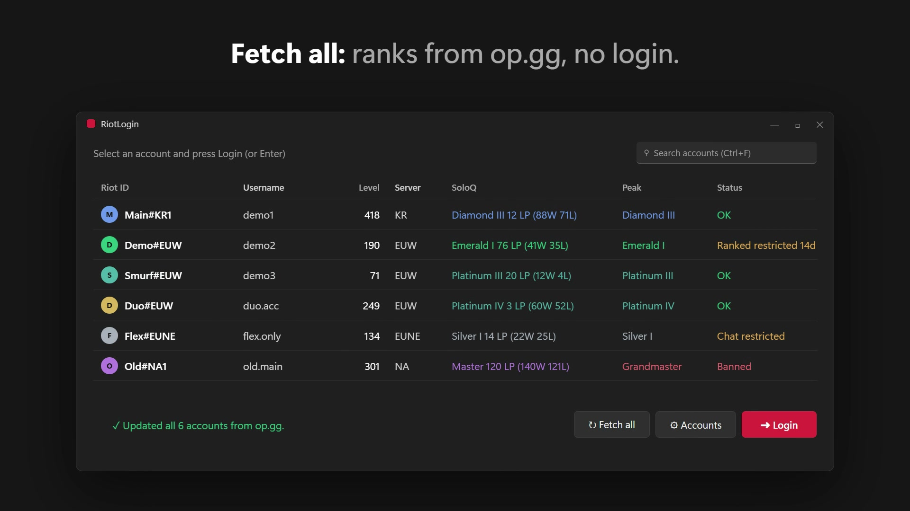
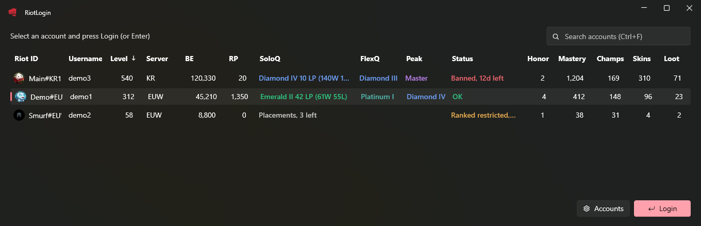
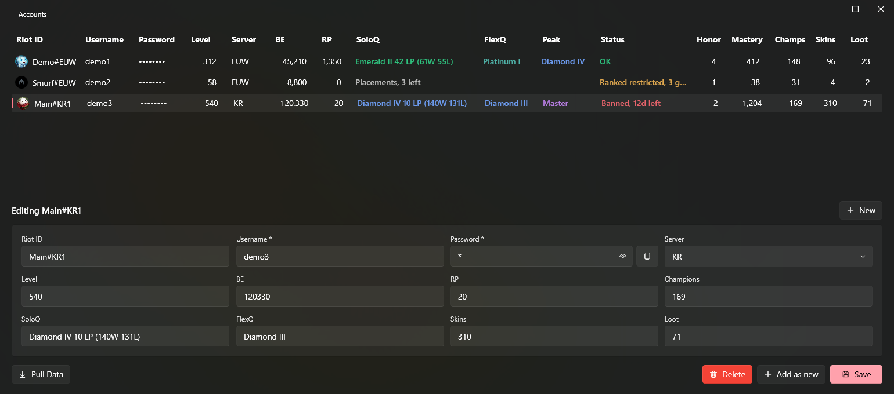

<div align="center">

# RiotLogin

**One-click account switching for League of Legends, with every account's rank, status and stats on one screen.**

[Download the latest release](https://github.com/Ku-Tadao/RiotLogin/releases/latest) · Windows 10/11 · no install needed

[](brag-output/brag.mp4)

*Click the image to watch the 20-second demo.*

</div>

## Why

If you play on more than one account, switching means signing out, typing a username and password, waiting, and launching League again. And you can't see at a glance which account is in which rank, which one is banned or which one has the BE for a champion.

RiotLogin keeps all your accounts in one list. Pick one, press **Login**, and it signs out the old account, signs in the new one and starts League for you.



## Features

### Switch accounts in one click
- **Login** (or double-click, or Enter) signs out the current account, signs in the one you picked and launches League.
- If that account is already signed in, it just launches League.
- Starts the Riot Client for you if it isn't running, and finds it automatically.
- Waits for you to enter a 2FA code, and tells you if Riot rejects the password.
- Won't switch while you're in a game.

### See every account at a glance
- Riot ID with profile icon, level, server, BE and RP.
- SoloQ and FlexQ rank with LP and wins/losses, coloured by tier, plus your peak rank this season.
- **Status:** OK, Banned (with days left), Ranked restricted or Chat restricted.
- Honor level, mastery score, and champion, skin and loot counts.
- Sort by any column, and search with Ctrl+F.

### Keep it up to date
- **Fetch all** updates level, icon, SoloQ, FlexQ and peak for *every* account from op.gg in a few seconds, without logging into any of them.
- **Pull Data** (in Accounts) reads everything from the League client for the account you're signed into: BE, RP, ranks, champions, skins, loot, honor, mastery and ban status.

### Manage accounts
- Add, edit and delete accounts in the **Accounts** window.
- Right-click any account to copy its username, password or Riot ID.
- Remembers its window size and the last account you used.



## Getting started

1. Download `RiotLogin.exe` from the [latest release](https://github.com/Ku-Tadao/RiotLogin/releases/latest) and put it in its own folder. It's a single self-contained file, so you don't need to install .NET.
2. Run it, then open **Accounts** and add your accounts. Username and password are required. Add the Riot ID (`Name#TAG`) and server too if you want Fetch all to work.
3. Press **Fetch all** to fill in ranks for every account.
4. Pick an account and press **Login**.

To fill in BE, skins, honor and bans, log into an account, open League, then go to **Accounts** and press **Pull Data**.

## Good to know

- **Your accounts are saved in `info.json` next to the exe, and passwords are stored as plain text.** Keep that folder private and don't share or upload the file.
- Fetch all only sees public data, and it is only as fresh as op.gg's last update of that profile. If an account isn't found, check its Riot ID and server.
- Login pastes your username and password into the Riot Client's sign-in screen through the clipboard, so don't use the keyboard or clipboard for a moment while it signs in.

## Is it safe to use?

RiotLogin doesn't touch the game. It fills in the Riot Client's login screen and reads data through the clients' own local APIs, which are the same APIs the clients use themselves. Riot Support told the original author they can't promise tools like this are safe with Vanguard running, though a ban is very unlikely. **Use it at your own risk.**

## Building from source

You need the [.NET 10 SDK](https://dotnet.microsoft.com/download).

```
dotnet publish RiotLogin/RiotLogin/RiotLogin.csproj -c Release -o publish
```

That produces `publish/RiotLogin.exe`. Every push to `main` builds a new release automatically.

Built with WPF on .NET 10 and [WPF UI](https://github.com/lepoco/wpfui). Profile icons come from [CommunityDragon](https://communitydragon.org) and public rank data from [op.gg](https://op.gg).

## Credits

- [lithellx](https://github.com/lithellx): the original RiotLogin
- [Ku-Tadao](https://github.com/Ku-Tadao): this version

*RiotLogin isn't endorsed by Riot Games and doesn't reflect the views or opinions of Riot Games or anyone officially involved in producing or managing Riot Games properties. Riot Games and all associated properties are trademarks or registered trademarks of Riot Games, Inc.*
